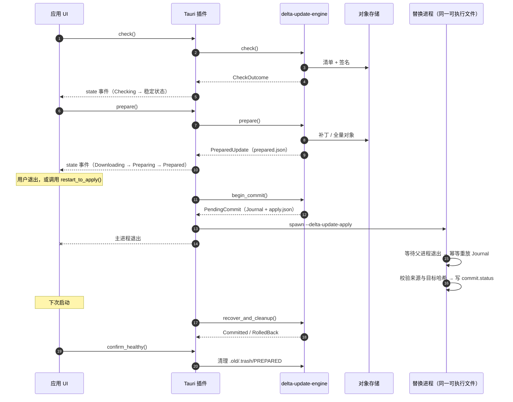

# Delta Update Engine 架构设计文档

> 一个面向 Tauri 应用的文件级增量更新内核，核心引擎与 Tauri 解耦，也可被任意 Rust 程序直接使用。以下载字节数的理论最小化为目标，以“不打断使用、重启即生效、免安装器”为体验底线，以三层解耦、构建侧极致压补丁、运行侧原子替换与自愈回滚为工程核心。

---

## 1. 设计目标与不妥协项

| 维度       | 目标                                                         |
| ---------- | ------------------------------------------------------------ |
| **流量**   | 只传输“信息增量”。未变化文件零传输；变化文件走最优差分管线；已压缩数据不做无意义差分。 |
| **体验**   | 更新全程不打断用户。下载、差分、暂存均在后台完成；用户下次启动软件即为新版本。 |
| **可靠性** | 任意一步失败、断电、崩溃，安装目录都不会停留在不可用的半更新状态。 |
| **自愈**   | 新版本启动即崩溃时，自动回滚到上一个可用版本，用户至少能打开软件。 |
| **安全**   | 未通过签名验证的字节永不进入安装目录；前端 WebView 被攻破也无法强制替换文件。 |
| **接入**   | 开发者四步接入：注册插件、main 最前面处理 worker、写配置、授默认权限。无需理解差分算法。 |

不妥协项：**免安装器引导**、**rename-then-replace 热替换**、**签名先于替换**、**两阶段提交**。这四项是“demo 级”与“生产级”的分水岭。

---

## 2. 分层架构

系统由三个 crate 构成，依赖方向严格单向，**引擎不依赖 Tauri，插件不依赖具体算法实现**。

```
┌──────────────────────────────────────────────────────────────┐
│  第三层  delta-update-cli                                     │
│  构建侧工具：扫描产物 → 生成清单 → 生成补丁 → 上传 COS         │
│  （独立二进制，运行于 CI，不进入用户机器）                      │
└───────────────────────────────┬──────────────────────────────┘
                                │ 复用引擎的 diff 能力
┌───────────────────────────────▼──────────────────────────────┐
│  第一层  delta-update-engine  （纯 Rust，零 Tauri 依赖）        │
│  ┌──────────┐ ┌──────────┐ ┌──────────┐ ┌──────────┐         │
│  │ Manifest │ │  Differ  │ │ Staging  │ │ Committer│         │
│  │  模块    │ │  模块    │ │  模块    │ │  模块    │         │
│  └──────────┘ └──────────┘ └──────────┘ └──────────┘         │
│  ┌──────────┐ ┌──────────┐ ┌──────────┐ ┌──────────┐         │
│  │ Fetcher  │ │  Journal │ │ Rollback │ │  Crypto  │         │
│  │  模块    │ │  模块    │ │  模块    │ │  模块    │         │
│  └──────────┘ └──────────┘ └──────────┘ └──────────┘         │
└───────────────────────────────┬──────────────────────────────┘
                                │ 生命周期钩子映射
┌───────────────────────────────▼──────────────────────────────┐
│  第二层  tauri-plugin-delta-update  （Tauri 2 适配层）         │
│  · Builder 注册与配置解析                                     │
│  · setup 最早期：recover_and_cleanup()                        │
│  · setup 稍后：auto_check → 后台 prepare                      │
│  · Event 广播：delta-update://state（单一事件）                │
│  · 命令暴露：check / prepare / cancel_prepare / status         │
│              / confirm_healthy / restart_to_apply             │
└──────────────────────────────────────────────────────────────┘
```

**为什么这样切**：引擎可以脱离 Tauri，用两棵目录树在 CI 中跑通 `prepare → commit → rollback` 全闭环，无需启动 GUI。插件层只做生命周期映射与配置解析，代码量小、审查面窄。构建工具复用引擎的 diff 能力，保证“生成补丁”与“应用补丁”使用同一套算法实现，避免两端格式漂移。

---

## 3. 数据流总览

```
  构建侧（CI）                                   运行侧（用户机器）
┌────────────────┐                          ┌──────────────────────┐
│ 旧版本产物目录  │                          │ 已安装目录（根目录 R）│
│ 新版本产物目录  │                          │   App.exe            │
└───────┬────────┘                          │   bin/core.dll       │
        │ 逐文件比对                         │   resources/...      │
        ▼                                    └──────────┬───────────┘
┌────────────────┐      上传                    │ 扫描 + 哈希
│ 生成 latest.json│──────────────┐              ▼
│ 生成 *.tdp      │              │      ┌────────────────┐
└────────────────┘              │      │ 本地清单生成    │
                                ▼      └───────┬────────┘
                         ┌──────────────┐      │ 逐文件比对
                         │   COS 桶      │      ▼
                         │ manifests/    │  ┌────────────────┐
                         │ artifacts/    │◄─┤ 差异文件列表    │
                         └──────┬───────┘  └───────┬────────┘
                                │ 预签名下载        │ 下载补丁 + 应用
                                ▼                  ▼
                         ┌─────────────────────────────────┐
                         │ 暂存区 Staging（prepare 阶段）    │
                         │  变化文件暂存 + 全量目标哈希校验   │
                         └───────────────┬─────────────────┘
                                         │ 全部校验通过
                                         ▼
                         ┌─────────────────────────────────┐
                         │ Commit（rename-then-replace）     │
                         │  写 Journal → 旧文件改名 → 新文件就位│
                         └───────────────┬─────────────────┘
                                         │ 用户下次启动
                                         ▼
                         ┌─────────────────────────────────┐
                         │ recover_and_cleanup()            │
                         │  检测崩溃循环 / 清理 .old / 复用缓存│
                         └─────────────────────────────────┘
```

---

## 4. 核心机制

### 4.1 文件清单（Manifest）——系统的唯一事实来源

清单是“哪些文件是官方的、各是什么哈希”的权威记录。更新器不关心安装绝对路径，只关心 `根目录 R + 相对路径`。这使得“单 exe”与“多 dll”共用同一套逻辑。

```json
{
  "schema": 1,
  "version": "2.1.0",
  "channel": "stable",
  "min_client_schema": 1,
  "files": {
    "App.exe":            { "sha256": "…", "size": 10240,
                            "strategy": "zucchini+zstd",
                            "delta_key": "artifacts/2.0.0-to-2.1.0/App.exe.tdp",
                            "delta_size": 1832,
                            "full_key":  "artifacts/full/2.1.0/App.exe" },
    "bin/core.dll":       { "sha256": "…", "size": 20480,
                            "strategy": "qbsdiff+zstd",
                            "delta_key": "artifacts/2.0.0-to-2.1.0/bin/core.dll.tdp",
                            "delta_size": 3011,
                            "full_key":  "artifacts/full/2.1.0/bin/core.dll" },
    "resources/icon.png": { "sha256": "…", "size": 5120,
                            "strategy": "full",
                            "full_key":  "artifacts/full/2.1.0/resources/icon.png" }
  }
}
```

| 字段                   | 语义                                                   |
| ---------------------- | ------------------------------------------------------ |
| `sha256`               | 目标文件完整哈希。补丁应用后必须逐文件校验到此值。     |
| `strategy`             | 策略标识。缺失补丁时为 `full`。                        |
| `delta_key`/`delta_size` | 补丁对象键与字节数。`delta_size` 用于上限校验与进度。 |
| `full_key`             | 全量对象键。带补丁的条目必须提供，作为确定性回退来源。 |

**签名不写在清单里**：清单是 minisign 的 detached 签名对象，签名文件是 `<清单>.minisig`，签名覆盖**清单原始字节**。客户端先验签、后解析；`version`、所有 `delta_key`、`sha256` 都在签名保护范围内。**不需要再单独签署 `version`**——整份原始字节已经包含它。

**降级防护**：签名之外还有一层独立的版本守卫（SemVer 比较）。只有清单携带签名保护的 `rollback: true` 时，才允许向更低版本降级；MITM 无法伪造该字段。

### 4.2 补丁生成管线（构建侧，追求理论最小体积）

不同数据形态的冗余来源不同，**统一算法是浪费，按文件类型路由才逼近理论最小**。

```
                    每个变化的文件
                          │
                  ┌───────▼────────┐
                  │  文件类型路由   │
                  └───────┬────────┘
        ┌─────────────────┼──────────────────┬─────────────────┐
        ▼                 ▼                  ▼                 ▼
 你编译的 PE        第三方二进制        文本/JSON/资源      已压缩格式
 (exe/dll)          (sidecar)          (未压缩)           (png/jpg/…)
        │                 │                  │                 │
        ▼                 ▼                  ▼                 ▼
 ┌────────────┐    ┌────────────┐    ┌──────────────┐    ┌────────────┐
 │ Zucchini   │    │ qbsdiff /  │    │ qbsdiff 对比  │    │ 跳过差分   │
 │ 归一化     │    │ HDiffPatch │    │ zstd 字典     │    │ 传全量      │
 └─────┬──────┘    └─────┬──────┘    └──────┬───────┘    └────────────┘
       │                 │                  │
       └─────────────────┴──────────────────┘
                     │
                     ▼
        压缩后端候选：zstd-19 / lzma2-9 / 不压缩
                     │
                     ▼
              封装为 .tdp 容器
         （源哈希 + 目标哈希 + 目标大小 + 策略号）
                     │
                     ▼
        若补丁 ≥ 全量的 60% → 标记为全量传输
```

| 文件类别        | 默认管线                                    | 依据                                                 |
| --------------- | ------------------------------------------- | ---------------------------------------------------- |
| 自编译 PE       | Zucchini 归一化 → bsdiff/HDiffPatch → zstd  | 链接地址位移是最大伪差异源，归一化后补丁可降一个数量级 |
| 第三方二进制    | bsdiff 或 HDiffPatch → zstd                 | 无法反汇编归一化，但字节级差分仍有效                 |
| 文本/未压缩资源 | bsdiff **对比** zstd 字典，取小             | 两种编码各有优势，实测决定                           |
| 已压缩格式      | 跳过差分，传全量                            | 内部无冗余，差分结果可能反超全量                     |
| 未变化文件      | 不进入管线                                  | 哈希比对已排除                                       |

**默认管线与可选加速器**：默认使用 **纯 Rust 的 qbsdiff + zstd**，依赖面窄、跨平台一致、无 C++ 构建风险。Zucchini 归一化与 HDiffPatch 是构建侧的**可选加速器**：它们在 CI 中生成更小的候选补丁，运行侧只要能按容器策略号分发即可。发布端缺少某个加速器时，自动退化为默认管线，不影响协议兼容。

**当前实现边界**：当前版本只实现 `qbsdiff + zstd` 默认管线；Zucchini、HDiffPatch、lzma2、zstd 字典均为规划中的构建侧加速器，客户端没有对应 apply 实现。发布端不得生成这些策略，否则客户端只能回退全量或拒绝清单。**不要把规划写成已实现能力。**

**候选补丁统一封装**：无论使用哪种差分/压缩组合，最终都封装进 `.tdp` 容器（见协议文档 §4）。容器头携带源哈希、目标哈希、目标大小与策略号，使运行侧在解压前即可拒绝不匹配的补丁，也避免了“补丁格式各不相同、运行侧要理解每种算法元数据”的耦合。

### 4.3 下载与传输层

| 机制                | 行为                                                |
| ------------------- | --------------------------------------------------- |
| 断点续传            | 单机网络不可控，下载中断后从断点继续。              |
| 预签名 URL 自动刷新 | URL 过期时向签名服务换取新 URL 并续传，不报错退出。 |
| 即时完整性校验      | 下载完成立即校验字节数与容器头，不匹配即弃并重取。  |
| 并发控制与限速      | 限制文件级与 Range 分块并发；**尚未实现带宽限速**   |
| 资源上限            | 清单、签名、补丁、全量对象均有硬上限，超限拒绝。    |
| 主机白名单          | 可选 `allowed_hosts`，防止被签名服务引导到任意主机。 |

传输层抽象为 `Fetcher` trait，引擎不绑定具体 HTTP 客户端，便于测试与替换。**签名服务只负责换取下载 URL，不参与验签**；验签始终在客户端用内嵌公钥完成，服务端被攻破也无法注入未签名字节。

### 4.4 暂存与两阶段提交（Prepare → Commit）

这是“重启生效”能够成立的前提。**下载与差分绝不在安装目录中进行**，全部在暂存区完成。

```
┌──────────────── Prepare 阶段（后台，不触碰 R） ────────────────┐
│  1. 校验清单签名                                              │
│  2. 扫描本地目录 → 生成候选源树（用于差分基准）                  │
│  3. 下载补丁 → 应用到暂存区 → 只物化 Modified/Added 文件        │
│  4. 逐文件校验：暂存文件校验哈希；未变化文件在 R 内原地校验       │
│  5. 全部验证通过 → 标记 PREPARED，写入暂存计划                  │
└───────────────────────────────┬───────────────────────────────┘
                                │ 用户退出应用 / restart_to_apply
┌───────────────────────────────▼───────────────────────────────┐
│  替换进程（应用退出后运行，非 Tauri）                          │
│  1. 拿 update.lock → 写 journal（提交点）                       │
│  2. 对每个差异文件：旧文件 → .old/<commit_id>/ 备份              │
│  3. 暂存新文件 → 安装目录对应相对路径（跨卷时复制+原子替换）     │
│  4. 删除清单中不存在的旧官方文件 → 移入 .trash（不物理删除）      │
│  5. 写 commit.status=completed；Journal 保留到健康确认，供回滚      │
└────────────────────────────────────────────────────────────────┘
```

**暂存验证的完整含义**：prepare 结束时，**每一个目标文件**都必须被验证过——变化文件在暂存区按清单哈希校验，未变化文件在安装目录原地按清单哈希校验。两者合起来等价于“一棵完整可用的新版本文件树”，但**不需要把未变化文件复制一份**，峰值磁盘从 `2 × |R|` 降到 `|R| + 变化文件总大小`。

**缓存复用**：用户本次不退出，已准备的结果持久化在暂存区。下次启动时 `recover_and_cleanup()` 识别 PREPARED 计划并复用，不重新下载。若暂存文件被外部篡改，复用时重新校验会发现并丢弃该计划。

**为什么 Commit 不在启动阶段做**：启动阶段运行的仍然是旧版本二进制。若在启动时替换文件，本次会话无法切到新版本，用户必须再重启一次，与“重启即新版本”的承诺冲突。因此正常提交发生在**应用退出之后**；启动阶段只负责恢复被中断的提交与崩溃回滚。

### 4.5 替换执行：rename-then-replace + Journal

运行中的 exe/dll 不能被覆盖，但可以被重命名。这是“不关软件”体验的技术核心。

```
安装目录 R                          暂存区 Staging
┌──────────────┐                  ┌──────────────┐
│ App.exe      │──rename──►       │ App.exe      │
│ .old/<id>/…  │                  │ (新版本)      │
└──────────────┘                  └──────┬───────┘
       ▲                                 │ move
       └──────────── 就位 ◄──────────────┘

当前进程仍持有旧映像（内存中），不受影响；
替换在应用退出后由独立进程完成，下次启动加载新版本。
```

**替换进程**：主进程在触发提交时 spawn 同一已签名二进制的受限模式（`--delta-update-apply <journal_dir> <commit_id> [--relaunch]`），然后退出。替换进程不加载 WebView、不初始化 Tauri，只读取 Journal 并执行文件操作。普通用户安装以当前用户身份运行；`Program Files` 安装以受限提权 worker 身份运行（见权限文档）。worker 要求 `apply.json` 的 `install_root` **精确等于自身可执行文件目录**，拒绝更宽的祖先目录；staging/journal 必须在安装根之外。

**跨卷移动**：暂存区与安装目录不在同一卷时，`move` 退化为“复制到目标目录临时文件 → fsync → rename”，不会留下半写目标。Windows 上为避免覆盖占用文件，`rename` 前会先删除目标，因此存在极短的“目标缺失”窗口；崩溃后由 journal 幂等重放恢复，不会停留在半写状态。

**Journal 日志**：多文件替换在第 3 个文件时断电，会留下“前 2 个已换、后 2 个未换”的半更新状态。Journal 逐条记录 `{文件, 备份, 暂存源, 目标哈希, 状态}`，启动时据此**幂等续完或回滚**，保证目录状态可判定、可恢复。`commit.meta.json` 把 `commit_id`、`manifest_hash`、版本与 `install_root` 绑定到 `verified_manifest.json` 的 minisign 签名；worker 用内嵌公钥验签，并要求每个 `Place` 的目标哈希/大小出现在签名清单中。checksum 只用于发现损坏，不作为认证。

**软删除策略**：清单中不存在的旧官方文件不直接 `remove`，先移入 `.trash/`。待新版本确认健康后再物理清理，为回滚保留物理素材。

### 4.6 回滚与崩溃循环保护

最危险的场景不是“更新失败”，而是“更新成功但新版本一启动就崩溃”。

```
 启动（bootstrap 层，早于主窗口）
        │
        ▼
 attempts += 1
        │
        ├── attempts ≤ 阈值 ──► 正常启动，等待 confirm_healthy
        │
        └── attempts > 阈值 ──► 触发回滚
                              │
                     ┌────────▼────────┐
                     │ 生成回滚 Journal │
                     │ 恢复 .old/.trash │
                     └────────┬────────┘
                              ▼
                     以旧版本启动，用户可用
```

默认阈值 `2` 表示：连续两次启动都未确认健康，**第三次启动时回滚**。`confirm_healthy()` 把计数清零。阈值不随更新重置，持续崩溃的旧版本也会被检测。

**回滚素材恢复**：回滚不仅要还原 `.old`，还要把 `.trash/` 中被删除的旧官方文件恢复回原位，并删除新版本新增的文件。回滚本身也通过一份向前重放的 Journal 执行，可被中断并再次恢复。

**回滚后跳过同一版本**：回滚完成后记录 `skipped_version`，在该版本仍是远程最新版本时，自动检查不再自动 prepare 它；远程出现更高版本或携带 `rollback: true` 的清单时清除跳过标记。**不设时间窗口**——时间窗口会让用户在 1 小时后再次踩同一个崩溃版本。

**关键点**：回滚决策必须在主程序逻辑**之前**执行。新版本主程序若根本起不来，任何写在其后的逻辑都无法运行。因此 `recover_and_cleanup()` 挂在 Tauri `setup` 的**最早期**，作为独立于业务代码的引导层。`confirm_healthy()` 由前端在 UI 就绪后调用（或由 `auto_confirm` 在页面加载后延迟调用），只有它被调用，旧备份才允许被删除。

### 4.7 安全信任链

```
 私钥（离线保管）                     公钥（编译期内置）
      │                                    │
      ▼                                    ▼
 清单签名 ──────► COS ──────► 客户端 ──验证──► 暂存区
      │                        (HTTPS)          │
      ▼                                       ▼
 补丁 .tdp（源/目标哈希头）      未通过校验：字节不进入安装目录
```

| 机制            | 规则                                                         |
| --------------- | ------------------------------------------------------------ |
| 签名先于替换    | 签名验证在 prepare 阶段完成，未通过签名的字节永不落盘到 R。  |
| 传输 + 载荷双层 | HTTPS 防传输篡改，签名防载荷伪造，不依赖单一层。             |
| 版本防重放      | 签名绑定整份清单，版本守卫独立执行，拒绝未授权降级。         |
| 密钥轮换        | 公钥编译期内嵌，新公钥随二进制更新生效，无运行期信任集。     |

**补丁是不可信输入**：补丁容器携带源哈希与目标哈希，应用前校验源文件、应用后校验目标文件。**补丁对象没有独立签名是刻意的**——目标哈希是比“补丁字节哈希”更强的语义约束。

### 4.8 权限模型

Tauri 2 是 deny-by-default。插件默认权限包 `delta-update:default` 授予六个命令：`check`、`prepare`、`cancel_prepare`、`status`、`confirm_healthy`、`restart_to_apply`。

**替换文件、写入安装目录的能力不以命令形式暴露给 WebView**。rename-then-replace 在 Rust 层由引擎调度，前端无法指定文件、无法直接写入根目录、无法绕过签名。即使 WebView 被攻破，攻击者上限是“触发检查/准备/取消/重启已就绪的更新”，**无法强制替换任意文件、无法读取目录内容、无法绕过签名**。

安装在 `Program Files` 时的提权路径：插件的替换进程启动器先探测安装根写权限，不可写时通过 `ShellExecuteW("runas")` 启动受限 worker（同一已签名二进制）；worker 执行 Journal 后经 Explorer 降权拉起新版本。提交中断后的下次启动若需要写安装根，插件改用 `ShellExecuteExW("runas")` 同步执行 `--delta-update-recover` 恢复并等待结果；正常的“已提交待确认”启动不会弹 UAC。引擎只负责 worker 入口与 Journal 执行，提权决策留在插件层。

---

## 5. 生命周期编排（Tauri 插件层）

```
应用启动
   │
   ▼
setup() ──最早期──► recover_at_startup()
   │                   ├─ 需要写安装根且不可写 → 提权 worker（--delta-update-recover）并等待
   │                   ├─ 重放未完成的 Journal（上次退出时被中断的提交）
   │                   ├─ 崩溃循环检测 → 必要时回滚
   │                   ├─ 清理已确认健康的 .old / .trash
   │                   └─ 复用已 PREPARED 的暂存计划
   │
   ├── auto_check == true ──► 后台任务 engine.check_and_prepare()
   │                          └─ 完成 → emit("delta-update://state", Prepared)
   │
   ▼
主窗口出现，用户正常使用
   │
   ├── auto_confirm ──► 页面加载后延迟调用 confirm_healthy()
   │
   ▼
用户退出应用 / 调用 restart_to_apply()
   │
   ▼
spawn 替换进程 → 主进程退出
   │
   ▼
替换进程执行 Journal → 写 commit.status=completed（Journal 保留至健康确认）
```

**一次更新的端到端调用顺序**：



主程序 UI 可查询 `status` 展示“已准备好，下次启动生效”。状态变更通过单一事件 `delta-update://state` 广播，前端只读，不参与决策。

---

## 6. 接入体验（四步）

**第一步：注册插件**
```rust
.plugin(tauri_plugin_delta_update::init())
```

**第二步：在 `main` 最前面处理 worker 模式**
```rust
fn main() {
    let context = tauri::generate_context!();
    if let Some(code) = tauri_plugin_delta_update::run_applier_from_context(&context) {
        std::process::exit(code);
    }
    tauri::Builder::default()
        .plugin(tauri_plugin_delta_update::init())
        .run(context)
}
```
worker 从编译期内嵌的插件配置读取公钥，验签清单后再执行 journal；不要用不带 keys 的 `run_applier_from_args()`（仅迁移兼容）。遗漏这一步时，worker 模式会进入 Tauri setup 并报 `E_CONFIG_INVALID`，而不是静默开第二个实例。

**第三步：写配置**
```json
{
  "plugins": {
    "delta-update": {
      "config_version": 1,
      "endpoint": "https://your-cos.example.com/manifests/latest.json",
      "signing_public_keys": ["YOUR_PUBLIC_KEY_1", "YOUR_PUBLIC_KEY_2"],
      "auto_check": true,
      "auto_apply": false,
      "auto_confirm": false
    }
  }
}
```

**第四步：授予默认权限**
```json
{ "permissions": ["delta-update:default"] }
```

`auto_check` 默认 true；`auto_apply` 与 `auto_confirm` 默认 false。开发者需要显式决定是否允许退出时静默替换、以及何时认为应用健康；这避免了可选更新功能阻止主应用启动或过早确认坏更新。

**高级配置**（均有安全默认值，通常无需设置）：`crash_loop_threshold`、`staging_dir`、`journal_dir`、`signing_endpoint`、`allowed_hosts`。`patch_strategy` **刻意不在插件配置中**——补丁如何生成是构建侧决策，客户端只读策略标识。

---

## 7. COS 桶结构

插件只直接请求**清单 URL**（`endpoint`）；签名固定为同目录的 `<清单>.minisig`，补丁/全量对象键由清单内部指定。私有桶下这些 URL 通过 `signing_endpoint` 换取。COS 组织方式完全由构建工具管理。

```
/your-bucket/
  ├── manifests/
  │   ├── latest.json                 # 插件唯一直接请求的清单
  │   ├── latest.json.minisig
  │   ├── 2.0.0.json                  # 历史版本，供回滚/降级素材
  │   └── 2.0.0.json.minisig
  └── artifacts/
      ├── 2.0.0-to-2.1.0/
      │   ├── App.exe.tdp
      │   └── bin/core.dll.tdp
  └── blobs/
      └── <sha256>                    # 内容寻址的全量回退对象
```

**原子发布顺序**：先上传补丁与全量对象并 HEAD 校验，再上传签名，**最后上传 `latest.json`**。客户端只有在清单指向某对象时才拉取，顺序颠倒会出现“清单已更新但对象 404”或“清单已到但签名未到”的窗口。

---

## 8. 构建侧 CLI（delta-update-cli）

一条命令完成发布产物到 COS 的全流程，避免手工维护清单：

```
delta-update release \
  --from  ./dist/2.0.0 \
  --from-version 2.0.0 \
  --to    ./dist/2.1.0 \
  --version 2.1.0 \
  --bucket cos://your-bucket \
  --key   /tmp/release.key
```

内部顺序：

```
扫描 to/ → 计算每个文件的 SHA-256
      │
逐文件比对 from/ 与 to/
      │
Modified → qbsdiff+zstd 补丁；已压缩/过大 → 全量
      │
补丁 ≥ 全量 60% → 标记全量
      │
签名清单（离线私钥或 CI 密钥）
      │
上传补丁/全量 → 上传签名 → 最后上传 latest.json
```

CLI 与引擎共用 `.tdp` 容器与 `Strategy` 标识，保证“生成”与“应用”两端格式一致。

---

## 9. 推荐实现顺序

| 阶段 | 产出                                           | 验收标准                                          |
| ---- | ---------------------------------------------- | ------------------------------------------------- |
| 1    | `delta-update-engine` 骨架 + Manifest + Differ | 两棵目录树在 CI 中跑通 prepare，逐文件校验通过    |
| 2    | Committer + Journal + Rollback                 | 注入断电/异常，验证半更新状态可被检测并回滚       |
| 3    | Fetcher + 断点续传 + 预签名刷新                | 模拟断网与 URL 过期，下载可续、可恢复             |
| 4    | `tauri-plugin-delta-update` 生命周期映射       | 真实 Tauri 应用完成一次“后台准备、重启生效”全流程 |
| 5    | 崩溃循环检测 + `confirm_healthy`               | 注入启动崩溃，验证自动回滚                        |
| 6    | `delta-update-cli` + 策略路由 + 双候选取小     | 一次真实版本发布，补丁体积达到预期基线            |
| 7    | Zucchini / HDiffPatch 可选加速器接入           | 主 exe 补丁体积相比默认管线显著下降               |
| 8    | 替换进程 + `restart_to_apply`                  | 退出后自动替换、立即重启、跨卷安装均可用          |

**关键判断**：决定“能否上生产”的是阶段 2、3、5（原子性、传输韧性、自愈），而非差分算法本身。差分能力可以借用成熟实现，**原子替换与回滚语义必须自研且经过故障注入验证**。

---

## 10. 与官方更新器及 delta 插件的定位差异

| 方案                       | 下载优化       | 是否过安装器 | 是否免关闭 | 生效方式                          |
| -------------------------- | -------------- | ------------ | ---------- | --------------------------------- |
| tauri-plugin-updater       | 全量安装包     | 是（静默）   | 否         | 安装器执行                        |
| tauri-plugin-updater-delta | 补丁重建安装包 | 是（静默）   | 否         | 安装器执行                        |
| **Delta Update Engine**    | 文件级最小补丁 | **否**       | **是**     | **rename-then-replace，重启生效** |

本架构承担了前两者不承担的责任：journal、回滚、崩溃循环检测、提权路径。这些复杂度被封装在 `delta-update-engine` 内部，开发者不可见，却是“高于生产级”的真实成本与价值所在。