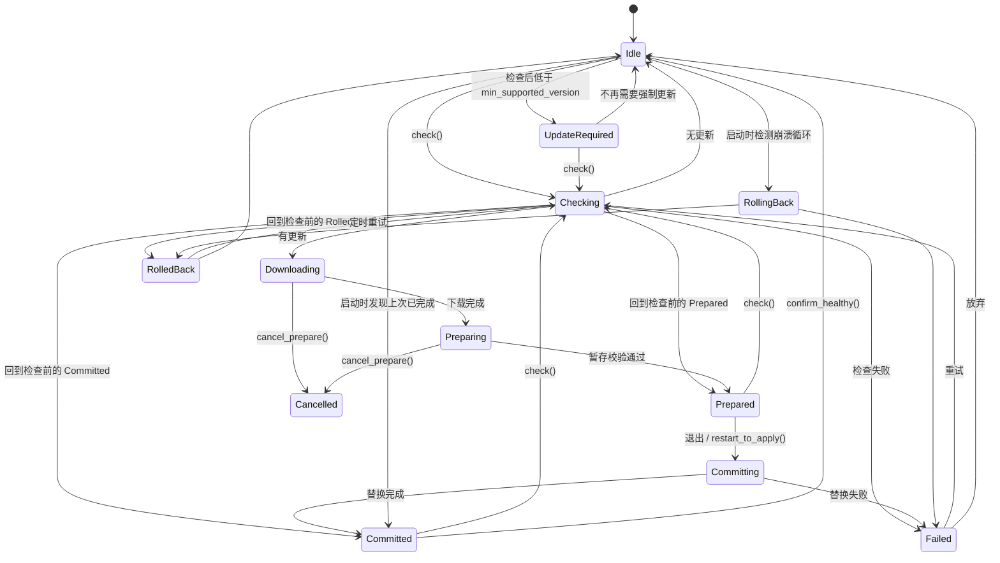

# 运行时协议：状态机、错误与命令

> 本文件是 [协议规范](protocol.md) 的运行时部分：状态迁移、事件 payload、错误对象与命令语义。

## 6. 状态机与事件协议

### 6.1 状态枚举

```
Idle
UpdateRequired { version: string, min_supported_version: string } // 低于发布者最低支持版本
Checking
Downloading { total: u64, completed: u64 }
Preparing { verified: u32, total: u32 }
Prepared { version: string }            // 已就绪，等待退出/立即重启
Cancelled { version: string }           // 用户取消 prepare
Committing { processed: u32, total: u32 } // 主进程已退出；插件发布 0/0，表示 indeterminate
Committed { version: string }           // 替换完成，等待健康确认
RollingBack { to_version: string, reason: string }
RolledBack { to_version: string, reason: string }
Failed { category: string, error: ErrorPayload }
```

### 6.2 合法迁移



**恢复路径是合法迁移**：`Idle → Committed` 与 `Idle → RollingBack` 不是异常，而是“上次运行结束时完成/失败、本次启动才观测到”的正常路径。

**`Checking` 是瞬态**：检查结束后会回到检查前的稳定状态（`Idle`、`Prepared`、`Committed`、`RolledBack`），或进入 `Downloading`；这些回流不是非法迁移。命令入口按状态规则拒绝不合法调用并返回 `E_INVALID_TRANSITION`；状态推送只表达真实发生的操作，不承载任意跳转。

**`Committing` 的可观测性**：主进程在触发替换后立即退出，通常观测不到 `Committing`。该状态只出现在替换进程日志与下一次启动的恢复日志中；事件协议仍保留它，用于诊断与测试。

### 6.3 Tauri 事件 payload

事件名：`delta-update://state`

```json
{
  "v": 1,
  "state": "Prepared",
  "version": "2.1.0",
  "target_version": "2.1.0",
  "progress": null,
  "error": null,
  "timestamp": "2026-11-10T08:00:00Z"
}
```

| 字段        | 类型         | 语义                                                         |
| ----------- | ------------ | ------------------------------------------------------------ |
| `v`         | u32          | 事件协议版本，当前 `1`。                                     |
| `state`     | string       | 状态枚举名。                                                 |
| `version`   | string\|null | 相关版本号；Downloading/Preparing/Committing/Failed 时为本次目标版本（如有），Prepared/Cancelled/Committed/RolledBack 时为对应版本。 |
| `progress`  | object\|null | `{ "total": u64, "completed": u64, "file": string\|null }`，仅 Downloading/Preparing/Committing 时非空；`file` 为当前正在下载/校验的文件（未知时省略）。 |
| `error`     | object\|null | 仅 Failed 时非空，结构见 7.2。                               |
| `min_supported_version` | string\|null | 仅 UpdateRequired 时非空：发布者仍支持的最低版本。 |
| `target_version` | string\|null | 最近一次检查找到的可用版本；**总是输出**，`null` 表示检查过但没有更新。窗口重新打开时可直接渲染“有 v2.1.0 可用”，无需再跑一次 `check`；旧版插件缺少该键时按“未知”处理。 |
| `skipped_version` | string\|null | 用户以“稍后提醒”跳过的版本，或回滚记录写入的版本。 |
| `timestamp` | string       | RFC 3339 UTC。                                               |

`min_supported_version` 与 `skipped_version` 使用 `skip_serializing_if = "Option::is_none"`：无可报告值时整个键省略。`target_version` 例外地总是输出（可为 `null`），以便 SDK 区分“检查过、没有更新”和“旧插件不支持该字段”。


## 7. 错误码协议

### 7.1 码值命名规则

`E_<CATEGORY>_<SPECIFIC>`，全大写下划线。**已发布码值永不重用、永不改义**。新增错误只能追加新码值。

### 7.2 错误对象结构

```json
{
  "code": "E_NETWORK_TIMEOUT",
  "category": "network",
  "message": "下载超时",
  "retryable": true,
  "action": "retry",
  "user_action": "检查网络后重试",
  "detail": ""
}
```

| 字段          | 语义                                             |
| ------------- | ------------------------------------------------ |
| `code`        | 稳定码值，程序可判断。                           |
| `category`    | 类别，用于 UI 分组。                             |
| `message`     | 开发者可读的简短描述。                           |
| `retryable`   | 是否可自动重试。                                 |
| `action`      | 稳定动作码，供 UI 本地化；不随文案变化。          |
| `user_action` | 面向用户的建议（中文，可直接展示）。              |
| `detail`      | 结构化上下文，`key=value; key=value`（如 `http_status=503`、`required_bytes=…`）；没有结构化值时为空字符串。只包含数值与枚举，不含路径或服务器原文。 |

`action` 取值：`retry`、`wait`、`check_update`、`contact_support`、`grant_permission`、`free_space`、`update_client`、`report_security`、`recover_backup`、`fix_config`、`unsupported`、`restart`。UI 应按 `action` 做本地化，而不是解析中文 `user_action`。`restart` 表示需要重启应用让启动期恢复收敛（典型是提权恢复等待超时）。

### 7.3 完整错误码表

| 码值                           | 类别       | 可重试 | 含义                             |
| ------------------------------ | ---------- | ------ | -------------------------------- |
| `E_NETWORK_CONNECT`            | network    | 是     | 连接失败                         |
| `E_NETWORK_TIMEOUT`            | network    | 是     | 超时                             |
| `E_NETWORK_HTTP_5XX`           | network    | 是     | 服务端 5xx                       |
| `E_NETWORK_HTTP_4XX`           | network    | 否（429 可重试） | 客户端 4xx（403 过期除外）       |
| `E_NETWORK_PRESIGN_EXPIRED`    | network    | 是     | 预签名 URL 过期，可刷新          |
| `E_NETWORK_RANGE_UNSUPPORTED`  | network    | 否     | 服务端不支持 Range，回退全量     |
| `E_NETWORK_SIGNING_SERVICE`    | network    | 是     | 签名服务不可用或返回非法响应     |
| `E_SIGNATURE_INVALID`          | signature  | 否     | 清单验签失败                     |
| `E_SIGNATURE_NO_TRUSTED_KEY`   | signature  | 否     | 无匹配受信公钥                   |
| `E_SIGNATURE_SIG_MISSING`      | signature  | 否     | 签名对象缺失                     |
| `E_VERSION_ROLLBACK`           | manifest   | 否     | 远程版本低于本地版本且未授权降级 |
| `E_VERSION_INVALID`            | manifest   | 否     | 版本号不是合法 SemVer            |
| `E_MANIFEST_SCHEMA_TOO_NEW`    | manifest   | 否     | schema 高于客户端支持            |
| `E_MANIFEST_PARSE`             | manifest   | 否     | 清单 JSON 解析失败或字段非法     |
| `E_MANIFEST_TOO_LARGE`         | manifest   | 否     | 清单字节数或条目数超限           |
| `E_PATH_ESCAPE`                | security   | 否     | 路径逃逸根目录                   |
| `E_PATH_INVALID`               | security   | 否     | 路径不符合 §1.3 规范             |
| `E_PATH_COLLISION`             | security   | 否     | 清单内路径在目标平台上大小写冲突 |
| `E_DISK_INSUFFICIENT`          | disk       | 否     | 磁盘空间不足                     |
| `E_DISK_STAGING_LIMIT`         | disk       | 否     | 暂存区超过上限                   |
| `E_PERMISSION_DENIED`          | permission | 是     | 写入被拒绝（可提权重试）         |
| `E_PERMISSION_UAC_CANCELLED`   | permission | 是     | 用户取消 UAC                     |
| `E_PATCH_SOURCE_MISMATCH`      | patch      | 是     | 本地源文件哈希不匹配，可回退全量 |
| `E_PATCH_APPLY_FAILED`         | patch      | 是     | 补丁应用失败，可回退全量         |
| `E_PATCH_TARGET_HASH_MISMATCH` | patch      | 是     | 目标哈希不匹配，可回退全量       |
| `E_PATCH_MEMORY_BUDGET`        | patch      | 否     | 内存预算超限，回退全量           |
| `E_PATCH_FORMAT_MISMATCH`      | patch      | 是     | 清单策略与补丁容器头不一致       |
| `E_PATCH_DECOMPRESSION_LIMIT`  | patch      | 否     | 解压输出超过清单声明的大小       |
| `E_PATCH_TOO_LARGE`            | patch      | 否     | 补丁对象超过上限                 |
| `E_FULL_TOO_LARGE`             | patch      | 否     | 全量对象超过上限                 |
| `E_UNKNOWN_STRATEGY`           | patch      | 否     | 未知策略且无 `full_key`（条目不可用） |
| `E_JOURNAL_CORRUPT`            | journal    | 否     | Journal checksum 失败或超限      |
| `E_JOURNAL_REPLAY_FAILED`      | journal    | 否     | 重放时遇到不可恢复错误           |
| `E_UPDATE_LOCKED`              | journal    | 是     | 另一个进程正在提交或恢复         |
| `E_ROLLBACK_FAILED`            | rollback   | 否     | 回滚自身失败，需人工介入         |
| `E_CONFIG_INVALID`             | config     | 否     | 插件配置缺字段或取值非法         |
| `E_CONFIG_MIGRATION_REQUIRED`  | config     | 否     | config_version 低于当前实现      |
| `E_ENDPOINT_INSECURE`          | config     | 否     | endpoint 或签名服务不是 HTTPS    |
| `E_UNSUPPORTED_PLATFORM`       | platform   | 否     | 当前平台不支持文件级替换         |
| `E_UNSUPPORTED_FORMAT`         | platform   | 否     | 当前安装形态不支持（如 deb/rpm） |
| `E_APPLY_HELPER_FAILED`        | apply      | 是     | 替换进程未能启动或异常退出       |
| `E_APPLY_RECOVERY_TIMEOUT`     | apply      | 是     | 提权恢复等待超时，重启后收敛     |
| `E_NOT_PREPARED`               | apply      | 否     | restart_to_apply 时没有就绪更新  |
| `E_CANCELLED`                  | internal   | 否     | 用户取消了 prepare               |
| `E_INVALID_TRANSITION`         | internal   | 否     | 状态机非法迁移                   |
| `E_INTERNAL`                   | internal   | 否     | 不应到达的分支                   |


## 8. 命令协议

### 8.1 通用约定

- 所有命令返回 `Result<T, ErrorPayload>`，`ErrorPayload` 结构同 §7.2。
- 命令**不接收任何文件路径参数**。路径由引擎内部从注册表/自身位置解析。
- 命令幂等：重复调用不产生副作用差异；并发调用被合并，不重复下载。
- **没有任何命令能指定“替换哪个文件”**。`restart_to_apply` 只能消费已经通过完整校验的 `Prepared` 状态。

### 8.2 `check`

**入参**：无
**返回**：
```json
{
  "available": true,
  "version": "2.1.0",
  "current_version": "2.0.0",
  "files_changed": 3,
  "files_staged": 2,
  "download_bytes": 1048576,
  "total_bytes": 12582912,
  "notes": "修复了若干问题",
  "mandatory": false,
  "update_required": false,
  "min_supported_version": "1.9.0"
}
```
**语义**：拉取清单、验签、比对，返回是否有更新、预估下载量与全量体积。`files_changed` 包含删除，`files_staged` 只包含需要下载/应用的文件；`notes` 与 `mandatory` 来自清单。`update_required` 表示本地版本低于同一通道清单的 `min_supported_version`（客户端不强制阻止，由应用决定严格程度）；不同通道的清单不会影响它。**不下载补丁**。`available: false` 时 `version` 为 `null`，其余字段仍填充。与 `prepare` 互斥：prepare 进行中调用返回 `E_INVALID_TRANSITION`。检查失败时若已有 `Prepared` 或未确认的 `Committed`，保留原状态。

### 8.3 `prepare`

**入参**：无（目标版本由最近一次 `check` 验签通过的清单确定，前端无法指定任意版本）
**返回**：
```json
{ "state": "Prepared", "version": "2.1.0" }
```
**语义**：执行完整的 prepare 阶段（下载 + 差分 + 暂存校验）。若此前没有验签通过的清单，先执行一次 `check`。若已有同一版本的 `Prepared` 缓存，直接复用。若正在 prepare，返回当前进度状态而不是启动第二次下载（例如 `{"state":"Preparing","version":"2.1.0"}`）。等待健康确认的 `Committed` 状态下拒绝新的 prepare，返回 `E_INVALID_TRANSITION`。

### 8.4 `cancel_prepare`

**入参**：无
**返回**：`{ "state": "Cancelled" }`
**语义**：请求取消正在进行的 prepare。已下载的临时文件保留到下次 prepare，用于断点续传；`Prepared` 状态不受影响（已完成的不回退）。

### 8.5 `status`

**入参**：无
**返回**：当前状态快照（结构同 §6.3 payload）。

### 8.6 `confirm_healthy`

**入参**：无
**返回**：`{ "acknowledged": true }`
**语义**：标记当前运行版本健康。重置启动尝试计数。触发旧备份清理。**只有它被调用，`.old` / `.trash` 才允许物理删除**。成功确认后状态回到 `Idle`。没有待清理的已完成提交时，健康确认不需要 `update.lock`，因此长时间 prepare 持锁期间也能完成计数重置；只有确实存在 `completed` 提交时才获取锁并清理。

### 8.7 `restart_to_apply`

**入参**：无
**返回**：`{ "state": "Committing", "version": "2.1.0" }`

**语义**：仅当状态为 `Prepared` 时有效。插件 spawn 替换进程，然后退出应用。替换进程在应用退出后执行 Journal 并拉起新版本。

- 无 `Prepared` 更新 → `E_NOT_PREPARED`，不退出应用。
- 用户直接关闭应用等价于调用本命令的“退出后自动应用”路径（受 `auto_apply` 控制）。
- 本命令不能指定文件、不能跳过验签、不能绕过暂存校验。


