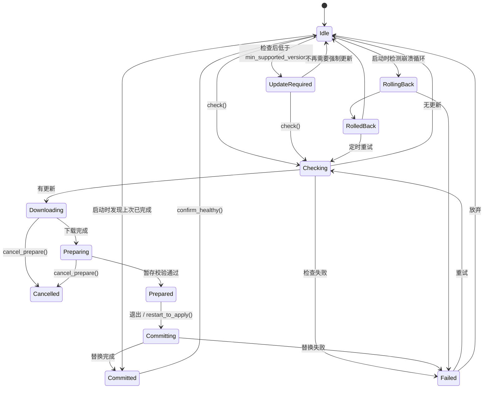

# Delta Update Engine 协议与数据格式规范

> 本文是三端（engine / plugin / cli）实现共同遵守的唯一协议契约。任何字段、格式、语义的变更都必须先更新本文档，再改代码。文档本身按 `schema` 版本号管理，与清单 `schema` 字段同步演进。
>
> 标识约定：仓库与核心 crate 同名 `delta-update-engine`，插件标识固定为 `delta-update`，配置键为 `plugins.delta-update`，权限标识为 `delta-update:default`，事件名为 `delta-update://state`。Tauri 的 identifier 采用短名，与项目名刻意不同，避免权限字符串里出现 `updater:default` 这种容易被误读为官方 updater 的形态。


## 1. 通用约定

### 1.1 版本化原则

| 对象            | 版本字段         | 当前版本 | 演进规则                                                     |
| --------------- | ---------------- | -------- | ------------------------------------------------------------ |
| Manifest        | `schema`         | `1`      | 新增可选字段不升版本；删除/改义必升版本                      |
| Journal         | `format`         | `1`      | 任何格式变更必须升版本，旧版本 journal 只读不可重放          |
| 补丁容器        | `format`         | `1`      | 任何格式变更必须升版本，未知格式回退全量                     |
| 事件 payload    | `v`              | `1`      | 新增字段不升版本；删除/改义必升版本                          |
| 错误码          | 码值本身         | —        | 已发布码值永不重用、永不改义                                 |
| 插件配置        | `config_version` | `1`      | 新增可选字段不升版本；必填字段变更升版本                     |

**版本号比较**：清单 `version` 与 CLI 的版本参数一律按 **SemVer 2.0.0** 比较——先比较主/次/修订号，预发布版本低于同号正式版（`2.0.0-rc.1 < 2.0.0`），构建元数据（`+build.1`）不参与比较。**禁止用字符串字典序比较版本**。`schema` / `format` / `config_version` 是单调递增的整数，按数值比较。

**客户端行为**：遇到高于自身支持版本的 `schema` / `format` / `config_version`，**拒绝并返回明确错误**，不尝试“尽力解析”。

### 1.2 编码与序列化

- 所有结构化数据使用 **UTF-8 JSON**，禁止 BOM。
- 键名使用 `snake_case`。
- 数值不使用科学计数法；大小字段为无符号整数，单位字节。
- 哈希统一为**小写十六进制字符串**，不带 `0x` 前缀。
- 时间统一为 **RFC 3339 UTC**（如 `2026-11-10T08:00:00Z`），仅用于诊断，不参与任何决策逻辑。

### 1.3 路径规范

- 清单中的文件路径为**相对路径**，使用 `/` 分隔，**不以 `/` 开头**。
- 路径大小写敏感性与文件系统一致；Windows 下比对时**规范化到小写**，但实际文件操作保留原始大小写。
- 禁止出现 `..`、`.`、空段、绝对路径、盘符、UNC 前缀、结尾 `/`。
- 单个路径总长度 ≤ **1024 字节**、段数 ≤ **64**；超过返回 `E_PATH_INVALID`。
- 禁止段尾的空格与句点（Windows 会静默去掉，导致清单与实际不一致）。
- 禁止 Windows 非法字符 `<`、`>`、`:`、`"`、`|`、`?`、`*` 与控制字符；盘符（如 `C:/x`）因此也会被拒绝。
- 禁止 Windows 保留设备名及其带扩展名形式：`CON`、`PRN`、`AUX`、`NUL`、`COM1`–`COM9`、`LPT1`–`LPT9`。
- **大小写冲突**：同一清单中两个路径按 ASCII 小写规范化后相同（如 `App.exe` 与 `app.exe`）时，整份清单拒绝，返回 `E_PATH_COLLISION`。该检查不区分目标平台，保证同一清单可跨平台复用。
- **保留目录**：首段为 `.old` 或 `.trash`（大小写不敏感）的安装路径一律拒绝，避免覆盖替换引擎的备份/回收目录。
- 违反路径规范的清单一律拒绝：结构违规返回 `E_PATH_INVALID`，规范化后逃逸根目录返回 `E_PATH_ESCAPE`。

### 1.4 对象键（COS Key）规范

```
manifests/latest.json
manifests/latest.json.minisig
manifests/<version>.json
manifests/<version>.json.minisig
blobs/<sha256>
artifacts/<from>-to-<to>/<relative_path>.tdp
```

`blobs/<sha256>` 是内容寻址的全量回退对象：每个文件条目都必须提供 `full_key`，包括 `Unchanged` 条目。这样任意本地文件损坏、跳过版本升级或回滚都能按目标哈希取回完整内容；相同内容只存一份。

`<from>`、`<to>`、`<version>` 使用语义化版本字符串，构建元数据（`+` 之后）在对象键中省略。

**签名对象定位**：签名对象与清单**同目录、固定后缀** `sig_key = manifest_key + ".minisig"`。客户端在解析清单之前就能确定签名 URL：

1. 配置了 `signing_endpoint`：向签名服务请求该 key 的下载 URL。
2. 未配置：以 `endpoint` 的**源站**（scheme + host）为基准拼接。例如 `endpoint = https://h/manifests/latest.json`，签名 URL 为 `https://h/manifests/latest.json.minisig`。

**为什么不在清单里放 `signature_ref`**：那会造成“先解析清单才知道签名在哪、但解析前必须先验签”的循环依赖。固定后缀让客户端**在解析任何未受信字节之前**就能拿到签名并完成验签。

**预签名 endpoint 的特殊规则**：如果 `endpoint` 本身带查询参数（预签名 URL），客户端无法从它推导出可下载的签名 URL。此时必须配置 `signing_endpoint`；否则在启动校验阶段返回 `E_CONFIG_INVALID`，而不是等到下载时才失败。


### 1.5 资源上限

所有上限都是**签名清单之外的安全边界**，用于抵御恶意或被劫持的服务端。超限一律拒绝，不做“尽力处理”。

| 对象                     | 上限                                    | 超限错误                       |
| ------------------------ | --------------------------------------- | ------------------------------ |
| 清单原始字节             | 8 MiB                                   | `E_MANIFEST_TOO_LARGE`         |
| 清单文件条目数           | 20 000                                  | `E_MANIFEST_TOO_LARGE`         |
| 清单发布说明             | 64 KiB                                  | `E_MANIFEST_PARSE`             |
| 签名文件                 | 64 KiB                                  | `E_SIGNATURE_INVALID`          |
| 单个补丁对象             | 1 GiB，且不得超过 `delta_size`          | `E_PATCH_TOO_LARGE`            |
| 单个全量对象             | 4 GiB，且不得超过清单 `size`            | `E_FULL_TOO_LARGE`             |
| 补丁解压输出             | 清单 `size`，超出 1 字节即中止          | `E_PATCH_DECOMPRESSION_LIMIT`  |
| Journal 文件             | 32 MiB / 100 000 个操作                 | `E_JOURNAL_CORRUPT`            |
| 单文件路径               | 1024 字节 / 64 段                       | `E_PATH_INVALID`               |

**为什么把上限放在协议层**：清单虽然经过签名，但签名只证明“发布者写了这些字段”，不证明“发布者不会误写一个 200 万条目的清单”。上限保护的是客户端自身的内存与磁盘，不依赖发布端的正确性。


## 2. Manifest 协议（`latest.json`）

### 2.1 顶层结构

```json
{
  "schema": 1,
  "version": "2.1.0",
  "channel": "stable",
  "published_at": "2026-11-10T08:00:00Z",
  "min_client_schema": 1,
  "notes": "修复了若干问题",
  "mandatory": true,
  "min_supported_version": "1.9.0",
  "signing_key_ids": ["a1b2c3d4e5f60718"],
  "files": { }
}
```

| 字段                    | 类型   | 必填 | 语义                                                    |
| ----------------------- | ------ | ---- | ------------------------------------------------------- |
| `schema`                | u32    | 是   | 清单格式版本。当前为 `1`。                              |
| `version`               | string | 是   | 语义化版本（SemVer 2.0.0）。与本地版本的关系见 §3.4。   |
| `channel`               | string | 否   | 更新通道，默认 `stable`。客户端按配置的通道过滤。       |
| `published_at`          | string | 否   | 发布时间，仅诊断用。                                    |
| `min_client_schema`     | u32    | 是   | 客户端最低支持 schema。低于此值的客户端拒绝使用本清单。 |
| `notes`                 | string | 否   | 发布说明，UTF-8，最大 64 KiB；仅用于展示。               |
| `mandatory`             | bool   | 否   | 强制更新标记，默认 `false`；是否阻止跳过由应用 UI 决定。 |
| `min_supported_version` | string | 否   | 发布者仍支持的最旧版本（SemVer，且 `<= version`）。低于它的客户端在 `check` 中收到 `update_required: true`，由应用决定是否阻止使用。 |
| `files`                 | object | 是   | 文件条目映射，键为相对路径。                            |
| `rollback`              | bool   | 否   | 显式降级标记，默认 `false`。语义见 §3.4。               |
| `signing_key_ids`       | array  | 否   | 附加签名的 key id 列表（每个 16 位小写十六进制），最多 8 个；文件为 `<清单>.minisig.<key_id>`。旧客户端忽略该字段。见 §3.1。 |

**清单中不存在的字段**：客户端一律忽略。**清单中不允许出现 `key_rotation` 一类运行期扩展信任集的字段**——信任锚只能随二进制更新，理由见 §3.3。

### 2.2 文件条目（`files` 的值）

```json
{
  "sha256": "a3f1…",
  "size": 10240,
  "strategy": "zucchini+zstd",
  "delta_key": "artifacts/2.0.0-to-2.1.0/App.exe.tdp",
  "delta_size": 1832,
  "full_key": "artifacts/full/2.1.0/App.exe",
  "executable": true
}
```

| 字段         | 类型       | 必填 | 语义                                                         |
| ------------ | ---------- | ---- | ------------------------------------------------------------ |
| `sha256`     | string(64) | 是   | 目标文件完整 SHA-256。补丁应用后必须校验到此值。             |
| `size`       | u64        | 是   | 目标文件字节数。用于磁盘空间预检与下载校验。                 |
| `strategy`   | string     | 是   | 补丁策略标识。取值见 2.3。无补丁时为 `"full"`。              |
| `delta_key`  | string     | 否   | 补丁对象键。`strategy == "full"` 时必须缺省。                |
| `delta_size` | u64        | 条件 | 补丁对象字节数。**存在 `delta_key` 时必填**，用于大小上限校验、进度与并发调度。 |
| `full_key`   | string     | 条件 | 全量对象键。**`Added`/`Modified` 必填；发布 CLI 对所有条目（含 `Unchanged`）都生成 `blobs/<sha256>`，用于跨版本与损坏修复。** |
| `executable` | bool       | 否   | 该文件是否为 PE/ELF 可执行体，供审计与诊断用。默认为 `false`。 |

**为什么 `full_key` 是条件必填**：它是所有变化文件与本地损坏文件的最终修复来源。**发布 CLI 会为每个条目（包括 `Unchanged`）生成 `full_key`，指向内容寻址的 `blobs/<sha256>`**。客户端对 `Added`/`Modified` 或本地哈希不匹配的条目要求 `full_key`；缺失时返回 `E_MANIFEST_PARSE`。旧版发布端如果只为变化文件生成 full_key，只能支持相邻版本且本地文件树完全健康；不建议继续这样做。

### 2.3 策略标识（`strategy`）取值

| 值               | 含义                                      | 运行侧行为                         |
| ---------------- | ----------------------------------------- | ---------------------------------- |
| `full`           | 不生成差分，直接下载 `full_key`           | 直接下载全量                       |
| `qbsdiff+zstd`   | bsdiff 差分 + zstd 压缩（默认管线）       | 解压后调用 bsdiff apply            |
| `qbsdiff+lzma2`  | bsdiff 差分 + lzma2 压缩                  | 解压后调用 bsdiff apply            |
| `hdiff+zstd`     | HDiffPatch 差分 + zstd 压缩               | 解压后调用 HDiffPatch apply        |
| `hdiff+lzma2`    | HDiffPatch 差分 + lzma2 压缩              | 解压后调用 HDiffPatch apply        |
| `zucchini+zstd`  | Zucchini 归一化 + bsdiff/HDiff + zstd     | 解压后调用 Zucchini apply 流程     |
| `zstd-dict`      | 以旧文件为字典的 zstd 压缩                | 调用 zstd 字典解码                 |

**当前客户端实现**：只支持 `full` 与 `qbsdiff+zstd`。`qbsdiff+lzma2`、`hdiff+*`、`zucchini+zstd`、`zstd-dict` 是保留标识，客户端不会 apply；发布端不得在正式清单中使用它们。未知策略仍可解析（不因未知值让整份清单失败），但运行时回退全量。

**客户端契约**：`strategy` 在协议层是**字符串**，不是封闭枚举。客户端可以把它解析为带 `Unknown(String)` 变体的内部类型，但**不得**因未知值导致整份清单解析失败。

`strategy` 取值**大小写敏感**，清单必须使用 §2.3 表中的小写形式（例如 `qbsdiff+zstd`）；`QBSDIFF+ZSTD`、`qbsdiff-zstd` 等变体会被当作未知策略处理并回退全量，客户端会记录警告但不会猜测发布端意图。

- 未知 `strategy` + 提供 `full_key` → 回退全量，记录诊断事件。
- 未知 `strategy` + 无 `full_key` → 该条目在差异计算时是 `Modified`/`Added`，客户端返回 `E_MANIFEST_PARSE`（缺少全量回退），不会静默跳过。
- **不尝试猜测策略**，也不按字符串前缀匹配。

### 2.4 差异分类规则（协议层定义，非实现细节）

| 本地状态       | 远程条目                         | 分类        | 行为                              |
| -------------- | -------------------------------- | ----------- | --------------------------------- |
| 存在，哈希一致 | 存在                             | `Unchanged` | 不下载、不替换；`strategy`/`delta_key` 被忽略 |
| 存在，哈希不同 | 存在                             | `Modified`  | 有 `delta_key` 走差分，否则走全量 |
| 不存在         | 存在                             | `Added`     | **直接走全量**，不进入差分管线    |
| 存在           | 不存在，且曾出现在任一历史清单   | `Removed`   | 移入 `.trash/`，不物理删除        |
| 存在           | 不存在，且从未出现在任何历史清单 | `Untracked` | **不处理**（保护用户数据）        |

`Untracked` 的判定依赖客户端维护的“历史官方文件集合”，该集合持久化在应用数据目录，首次迁移时为空。


## 3. 签名协议（`.minisig`）

### 3.1 签名对象

签名对象为 **minisign detached signature**，覆盖的是**原始清单字节**，而非解析后的 JSON。

每份清单有一个主签名 `<清单>.minisig`，以及零到多个附加签名 `<清单>.minisig.<key_id>`。附加签名在清单的 `signing_key_ids` 中声明；旧客户端只读主签名，因此主签名必须始终由当前所有受支持客户端都信任的密钥签发。多签名的动机与兼容矩阵见 [RFC 0001](../rfcs/0001-multi-signature-rotation.md)。

### 3.2 验签输入定义

```
signed_payload = raw_bytes_of(latest.json)
```

客户端必须：
1. 先下载 `.minisig` 与 `latest.json` 原始字节。
2. 用内嵌受信公钥集合中的**任意一把**验证主签名。
3. 主签名失败时，按 `signing_key_ids` 依次拉取 `.minisig.<key_id>`，**任一通过即接受**。
4. **验证通过后**才解析 JSON 用于更新决策。

`signing_key_ids` 在验签通过前来自不可信字节，只用于构造同目录的兄弟签名 URL：客户端只接受 16 位小写十六进制 id、最多 8 个，文件缺失或无效时忽略该条。清单从未通过验签时，绝不把它的其他字段用于更新决策。

**顺序不可颠倒**：先验签后解析，防止解析器差异引入的攻击面。

### 3.3 受信公钥集合与轮换

- 客户端二进制内嵌 **一组** minisign 公钥（至少 1 把，建议 2 把）。
- 验签条件：**任意一把受信公钥验证成功**即为通过。
- **信任集不可在运行期扩展**：客户端没有持久化信任集，也不接受清单中的新公钥。`key_rotation` 不是合法字段，出现时按“未知字段”忽略。

**为什么不做持久化信任集**：信任锚必须与二进制同生命周期。可写的信任集意味着本地用户只要能写应用数据目录，就能加入自己的公钥，再用自签清单替换 machine-wide 安装目录——这把“能写用户数据”提升为“能向受保护目录写入任意代码”。而这个能力换来的收益是零：插件随应用二进制分发，新增公钥本来就可以通过一次正常的二进制更新完成。

**轮换流程（无信任缺口）**：

```
v1 内嵌 {K1, K2}，用 K1 签名
v2 内嵌 {K2, K3}，由 K1 签名 → 旧客户端信任 K1，正常更新
v3 及之后    由 K2 或 K3 签名 → v2 起的客户端都信任
K1 在确认 v2 覆盖率达标后离线归档
```

轮换只依赖“新版本内嵌了新公钥”，不依赖客户端持久化任何状态，也不依赖清单携带信任指令。

### 3.4 版本与通道守卫

即使签名有效，客户端仍必须执行以下判定：

| 条件                                             | 行为                                                         |
| ------------------------------------------------ | ------------------------------------------------------------ |
| `version` > 本地版本                             | 正常更新                                                     |
| `version` == 本地版本                            | 无更新（`available: false`），不报错                         |
| `version` < 本地版本，`rollback != true`         | 拒绝，`E_VERSION_ROLLBACK`                                   |
| `version` < 本地版本，`rollback == true`         | 接受，记录降级来源；清除该版本的崩溃跳过标记                 |
| `channel` 与本地配置不一致                       | 无更新（`available: false`），不报错                         |
| `min_client_schema` > 客户端支持                 | 拒绝，`E_MANIFEST_SCHEMA_TOO_NEW`                            |
| 版本号不是合法 SemVer                            | 拒绝，`E_VERSION_INVALID`                                    |

**`rollback: true` 的完整语义**：

- 它是**签名保护的**字段，只有持发布私钥的一方能授权降级；MITM 无法伪造。
- 仅对“本地版本高于清单版本”的客户端生效。本地版本等于或低于清单版本时，按普通“无更新”处理，避免同一份回滚清单把已回滚的用户再拉回去。
- 接受降级后，客户端把“已安装版本”视为清单版本；后续正常发布必须以高于该版本的版本号发布。
- 降级不触发崩溃循环跳过逻辑，也不重置启动尝试计数。


## 4. 补丁对象协议

### 4.1 容器格式

所有差分补丁统一包在自有容器中。容器的作用是让运行侧在**解压之前**就能完成来源与目标的身份校验，而不依赖各差分算法自己的元数据。

```
┌────────────┬────────────┬───────────────┬─────────┬──────────┬───────────────┬───────────────┬──────────────┬─────────┐
│ magic (4B) │ format u16 │ strategy_id u16│ codec u8│ flags u8 │ target_size u64│ source_sha256 │ target_sha256│ payload │
│ "TDP1"     │ 0x0001     │ 见 4.2        │ 1/2/0   │ 保留 0   │ 目标字节数     │ (32B)         │ (32B)        │ 见 4.3  │
└────────────┴────────────┴───────────────┴─────────┴──────────┴───────────────┴───────────────┴──────────────┴─────────┘
```

- `codec`：`0` = 不压缩，`1` = zstd，`2` = lzma2。
- 所有整数字段为小端序。
- 清单中的 `sha256` 必须与容器头 `target_sha256` 一致；不一致时拒绝该补丁（`E_PATCH_FORMAT_MISMATCH`），回退全量。
- 清单 `strategy` 与容器 `strategy_id` 的映射由发布端保证一致；客户端以**容器头为准**执行，但若两者不一致，记录诊断事件并回退全量——不猜测哪一个是对的。

### 4.2 策略编号

| `strategy_id` | 清单 `strategy`  | 含义                                      |
| ------------- | ---------------- | ----------------------------------------- |
| `0x0001`      | `qbsdiff+zstd`   | bsdiff 差分，zstd 压缩（默认管线）        |
| `0x0002`      | `qbsdiff+lzma2`  | bsdiff 差分，lzma2 压缩                   |
| `0x0003`      | `hdiff+zstd`     | HDiffPatch 差分，zstd 压缩                |
| `0x0004`      | `hdiff+lzma2`    | HDiffPatch 差分，lzma2 压缩               |
| `0x0005`      | `zucchini+zstd`  | Zucchini 归一化 + bsdiff/HDiff，zstd 压缩 |
| `0x0006`      | `zstd-dict`      | 以旧文件为字典的 zstd 压缩                |
| `0xFFFF`      | 保留             | 未知策略，运行侧不得 apply                |

新增策略必须分配新编号并同步更新本表；清单 `strategy` 是字符串，客户端遇到未知字符串仍按 §2.3 处理。

### 4.3 载荷与压缩

`payload` 是差分字节经过 `codec` 压缩后的结果。若 `codec = 0`，`payload` 即差分字节本身。

**解压上限**：`payload` 解压后是差分算法的中间数据，必须有界读取。通用差分算法（qbsdiff 等）的中间数据上限为 `max_patch_file_size`（默认 256 MiB），超出立即中止并返回 `E_PATCH_DECOMPRESSION_LIMIT`；`zstd-dict` 的解压输出即目标文件，必须严格等于 `target_size`。**不能**无界解压到内存。应用差分后的目标文件在任何策略下都必须严格等于 `target_size`，否则该候选被丢弃并回退全量。

### 4.4 应用前置条件

客户端在应用补丁前必须验证：

1. 补丁对象下载完整：实际字节数与清单 `delta_size` 一致，且不超过 1 GiB。
2. 容器 magic/format 合法，`strategy_id` 在客户端支持范围内；未知编号直接回退全量。
3. 本地源文件 SHA-256 与容器头 `source_sha256` 一致；不一致返回 `E_PATCH_SOURCE_MISMATCH` 并回退全量。
4. 清单 `size` 与容器头 `target_size` 一致。
5. 暂存区有足够空间。

任一条件不满足，**不进入 apply**，直接回退到 `full_key`。

### 4.5 应用后置条件

应用完成后，目标文件必须：

1. 字节数与清单 `size` 一致。
2. SHA-256 与清单 `sha256` 一致。

**任一不一致 → 候选文件被丢弃 → 回退到全量 → 若全量仍失败则 prepare 整体失败**。

**为什么补丁不单独设哈希字段**：容器头已经把源哈希、目标哈希和目标大小绑定进补丁本身；目标哈希校验同时覆盖了“补丁字节完整”和“应用语义正确”。再维护一个补丁对象哈希只会增加清单体积和发布端出错面，不增加安全强度。


## 5. Journal 格式

### 5.1 设计目标

Journal 是 **write-ahead log**，在触碰根目录任何文件**之前**写入并 flush。**flush 成功即提交点**。提交点之后崩溃，恢复时向前重放；提交点之前崩溃，根目录未被触碰。

提交点之前还必须先落盘 `commit.meta.json` 与 `verified_manifest.json`/`.minisig`：worker 用内嵌公钥验签清单，并校验 journal 的 `Place` 目标哈希来自该清单。checksum 只发现损坏，不承担认证。验证通过后，worker 执行的是内存中已解码的同一份 Journal，不会按路径再次读取；`Backup.dst` 必须精确为 `.old/<commit_id>/<src>`，`Trash.trash_dst` 必须等于 `src`。

### 5.2 二进制格式

```
┌─────────────┬────────────┬───────────────┬──────────────┬───────────────┬─────────────────────────┬──────────────┐
│ magic (4B)  │ format u16 │ op_count u32  │ payload_len  │ commit_id(16B)│ payload                 │ checksum     │
│ "TDJ1"      │ 0x0001     │ N             │ u32          │ UUIDv4        │ version + op[0..N-1]    │ SHA-256(32B) │
└─────────────┴────────────┴───────────────┴──────────────┴───────────────┴─────────────────────────┴──────────────┘
```

- **Checksum 是尾部字段**，覆盖范围是**从 `magic` 到 `payload` 最后一个字节**（不含 checksum 自身）。校验失败 → `E_JOURNAL_CORRUPT`，**不尝试重放**。
- `payload` 内先写 `version_len u16 + version UTF-8`，再写 `from_version_len u16 + from_version UTF-8`，最后顺序写各 `op`。`from_version` 是提交前的运行版本，回滚时用于恢复到正确版本。
- 字符串字段编码为 `len u16 + UTF-8 bytes`；长度超过 1024 视为损坏。
- 整个文件不得超过 32 MiB / 100 000 个操作。上限与默认 `max_files = 20000` 对齐：即使一个安装的全部文件都被替换并伴随大量删除，也不会在提交点因容量不足失败。
- `commit_id` 用于把日志、诊断事件与替换进程的退出码关联起来；它不是安全边界。

**Checksum 不是认证**：本地攻击者可以重算 checksum。Journal 的安全性来自 **每个 `Place`/`Restore` 操作都携带目标哈希与大小**，重放时逐字节校验；伪造日志无法把未通过哈希校验的字节写进安装目录。

### 5.3 操作类型（`op`）

每个操作自包含，不依赖其他操作的结果。共五类：

| 类型          | 码值   | 字段                              | 语义                                                         |
| ------------- | ------ | --------------------------------- | ------------------------------------------------------------ |
| `Backup`      | `0x01` | `src`, `dst`                      | 将根目录中的 `src` 重命名为 `dst`（备份，仅当 `src` 存在）   |
| `Place`       | `0x02` | `staging_src`, `dst`, `sha256`, `size` | 将暂存区文件移入根目录 `dst`，落地后校验哈希与大小      |
| `Trash`       | `0x03` | `src`, `trash_dst`                | 将根目录旧官方文件移入 `.trash/`                              |
| `Restore`     | `0x04` | `backup_src`, `dst`, `sha256`, `size` | 从 `.old` 备份或 `.trash/` 恢复文件，落地后校验哈希与大小 |
| `RemoveTrash` | `0x05` | `trash_path`                      | 物理删除 `.trash/` 中的文件（只在 `confirm_healthy` 之后执行） |

**路径字段**：全部为相对路径，规则同 §1.3。

| 字段           | 解析根                                                        |
| -------------- | ------------------------------------------------------------- |
| `staging_src`  | 暂存区根 `staging/<version>/`                                  |
| `backup_src`   | 本次提交的备份根 `R/.old/<commit_id>/`，或 `.trash` 根 `R/.trash/<commit_id>/`（以 `old/` 或 `trash/` 前缀区分） |
| `dst` / `src`  | 安装根 R                                                      |
| `trash_dst`    | `R/.trash/<commit_id>/`                                       |

**每次提交使用唯一 `commit_id` 子目录**，因此 `.old` / `.trash` 不会与上一次残留或用户自建的同名文件冲突，也不需要时间戳后缀。启动清理只删除已经 `confirm_healthy` 的 `commit_id` 目录。三类根由 Journal 打开时从配置解析，**不从日志内容读取**。

**为什么 `Place` 必须携带哈希**：没有它，重放只能判断“目标是否存在”。本地攻击者改写暂存区文件并重算 checksum 后，日志会被当作合法意图执行，任意字节进入安装目录。携带哈希后，重放与正常提交走同一条“先校验来源、再落地、再校验目标”的路径，日志篡改无法绕过内容校验。

### 5.4 重放语义（幂等向前）

`recover()` 的行为：

```
for each op in journal.ops:
    if op 已经落地（目标状态成立且哈希匹配）:
        continue          # 幂等跳过
    else:
        执行 op（执行前后均校验哈希）
```

**“已经落地”的判定**：

- `Backup`：`dst` 存在，或 `src` 不存在（后续 `Place` 可能已重新填充 `src`）。
- `Place`：`dst` 存在、大小等于 `size`、SHA-256 等于 `sha256`。
- `Trash`：`trash_dst` 存在，或 `src` 不存在（`src` 可能在回滚/后续流程中重新出现）。
- `Restore`：`dst` 存在、大小与 SHA-256 匹配。
- `RemoveTrash`：`trash_path` 不存在。

**未落地且来源不可用**：`Place` 的暂存源不存在但 `dst` 哈希不匹配，或 `Restore` 的备份源不存在且 `dst` 不匹配 → 返回 `E_JOURNAL_REPLAY_FAILED`，停止重放，交由回滚流程处理。**不得跳过**——跳过会让目录停留在混合状态。

**执行前后校验**：

1. 执行 `Place`/`Restore` 前，计算来源文件哈希；不匹配 → `E_JOURNAL_REPLAY_FAILED`，不写入。
2. 执行后，计算目标文件哈希；不匹配 → 删除目标、保留来源（若仍存在），返回 `E_JOURNAL_REPLAY_FAILED`。

**并发**：提交与重放必须持有 `update.lock` 独占锁（见 §9.3）。拿不到锁的进程返回 `E_UPDATE_LOCKED`，不等待、不轮询，避免两个进程同时改同一批文件。

恢复过程本身可以被中断并再次恢复。**幂等性是恢复可靠性的核心性质**。

### 5.5 Journal 生命周期

```
prepare 完成，状态 Prepared
    │ 用户退出应用 / 调用 restart_to_apply
    ▼
主进程 spawn 独立替换进程（应用退出后运行）
    │
    ├── begin(root, ops) → 写入 + flush   ← 提交点
    │
    ├── 逐 op 执行（每次执行前后校验哈希）
    │
    ├── 全部完成 → mark_completed() → 写 commit.status=completed
    │                （Journal 与 .old/.trash 保留到 confirm_healthy，供回滚）
    │
    └── 中途崩溃 → 下次启动 recover() → 重放 → mark_completed()
```

`mark_completed()` 本身通过“写临时文件 + 原子 rename”完成，保证“要么完整存在，要么完全不存在”。

`commit.status=failed`（worker 执行失败）不会立刻回滚：下次启动先幂等重放一次，临时性原因（磁盘瞬时满、文件短暂被占用）可直接续完；仍失败则生成逆日志回滚到旧版本并记录 `skipped_version`，避免安装停留在混合状态。

**职责边界**：主进程只负责 `begin()` 之前的决策与 `begin()` 的写入；它是提交点的唯一作者。替换进程只消费已经固化的日志，不决定替换哪些文件。启动时的 `recover()` 只做恢复，不承担正常提交——正常提交发生在应用退出之后、下次启动之前。

### 5.6 回滚日志

回滚不是“把 `.old` 改回来”，而是**生成并执行另一份向前重放的日志**。这样回滚本身也能被中断并再次恢复。

回滚日志的生成规则（对提交日志逐条求逆）：

| 提交操作                       | 回滚操作                                                         |
| ------------------------------ | ---------------------------------------------------------------- |
| `Place{staging → dst}`         | 若旧版本存在该文件：`Restore{backup → dst}`；否则 `Trash{dst → .trash/<commit_id>/…}` |
| `Backup{src → .old/…}`         | `Restore{.old/… → src}`（与上一条成对出现，二选一，避免重复）     |
| `Trash{src → .trash/…}`        | `Restore{.trash/… → src}`                                        |
| `RemoveTrash{…}`               | 不可逆；回滚前不得执行 `RemoveTrash`                             |

**硬规则**：`RemoveTrash` 只在 `confirm_healthy()` 之后执行。健康确认之前的物理删除会让回滚失去素材，因此提交日志在健康确认前不包含 `RemoveTrash`。

**部分提交**：如果崩溃发生在某个 `Backup`/`Trash` 之前，对应备份素材不存在；求逆时跳过该条（旧文件仍在原位或尚未创建），不视为回滚失败。只有素材存在但恢复失败才是 `E_ROLLBACK_FAILED`。

**受信旧哈希**：`begin_commit` 在写 journal 前把将被替换/删除文件的 sha256 + size 写入 `old_hashes.json`。求逆生成的 `Restore` 使用这份快照校验备份；备份损坏时拒绝回滚，而不是用备份当前字节现算哈希后“自证正确”。


## 6. 状态机与事件协议

### 6.1 状态枚举

```
Idle
UpdateRequired { version: string, min_supported_version: string } // 低于发布者最低支持版本
Checking
Downloading { total: u64, completed: u64 }
Preparing { verified: u32, total: u32 }
Prepared { version: string }            // 已就绪，等待退出/立即重启
Cancelled { version: string }           // 用户取消 prepare
Committing { processed: u32, total: u32 } // 仅替换进程可见，主进程已退出
Committed { version: string }           // 替换完成，等待健康确认
RollingBack { to_version: string, reason: string }
RolledBack { to_version: string, reason: string }
Failed { category: string, error: ErrorPayload }
```

### 6.2 合法迁移



**恢复路径是合法迁移**：`Idle → Committed` 与 `Idle → RollingBack` 不是异常，而是“上次运行结束时完成/失败、本次启动才观测到”的正常路径。

**`Checking` 是瞬态**：检查结束后会回到检查前的稳定状态（`Idle`、`Prepared`、`Committed`、`RolledBack`），或进入 `Downloading`；这些回流不是非法迁移。命令入口按状态规则拒绝不合法调用并返回 `E_INVALID_TRANSITION`；状态推送只表达真实发生的操作，不承载任意跳转。

**`Committing` 的可观测性**：主进程在触发替换后立即退出，通常观测不到 `Committing`。该状态只出现在替换进程日志与下一次启动的恢复日志中；事件协议仍保留它，用于诊断与测试。

### 6.3 Tauri 事件 payload

事件名：`delta-update://state`

```json
{
  "v": 1,
  "state": "Prepared",
  "version": "2.1.0",
  "progress": null,
  "error": null,
  "timestamp": "2026-11-10T08:00:00Z"
}
```

| 字段        | 类型         | 语义                                                         |
| ----------- | ------------ | ------------------------------------------------------------ |
| `v`         | u32          | 事件协议版本，当前 `1`。                                     |
| `state`     | string       | 状态枚举名。                                                 |
| `version`   | string\|null | 相关版本号；Downloading/Preparing/Committing/Failed 时为本次目标版本（如有），Prepared/Cancelled/Committed/RolledBack 时为对应版本。 |
| `progress`  | object\|null | `{ "total": u64, "completed": u64, "file": string\|null }`，仅 Downloading/Preparing/Committing 时非空；`file` 为当前正在下载/校验的文件（未知时省略）。 |
| `error`     | object\|null | 仅 Failed 时非空，结构见 7.2。                               |
| `timestamp` | string       | RFC 3339 UTC。                                               |


## 7. 错误码协议

### 7.1 码值命名规则

`E_<CATEGORY>_<SPECIFIC>`，全大写下划线。**已发布码值永不重用、永不改义**。新增错误只能追加新码值。

### 7.2 错误对象结构

```json
{
  "code": "E_NETWORK_TIMEOUT",
  "category": "network",
  "message": "下载超时",
  "retryable": true,
  "action": "retry",
  "user_action": "检查网络后重试",
  "detail": ""
}
```

| 字段          | 语义                                             |
| ------------- | ------------------------------------------------ |
| `code`        | 稳定码值，程序可判断。                           |
| `category`    | 类别，用于 UI 分组。                             |
| `message`     | 开发者可读的简短描述。                           |
| `retryable`   | 是否可自动重试。                                 |
| `action`      | 稳定动作码，供 UI 本地化；不随文案变化。          |
| `user_action` | 面向用户的建议（中文，可直接展示）。              |
| `detail`      | 保留字段；当前实现为空，诊断信息写日志，避免路径泄露。 |

`action` 取值：`retry`、`wait`、`check_update`、`contact_support`、`grant_permission`、`free_space`、`update_client`、`report_security`、`recover_backup`、`fix_config`、`unsupported`、`restart`。UI 应按 `action` 做本地化，而不是解析中文 `user_action`。`restart` 表示需要重启应用让启动期恢复收敛（典型是提权恢复等待超时）。

### 7.3 完整错误码表

| 码值                           | 类别       | 可重试 | 含义                             |
| ------------------------------ | ---------- | ------ | -------------------------------- |
| `E_NETWORK_CONNECT`            | network    | 是     | 连接失败                         |
| `E_NETWORK_TIMEOUT`            | network    | 是     | 超时                             |
| `E_NETWORK_HTTP_5XX`           | network    | 是     | 服务端 5xx                       |
| `E_NETWORK_HTTP_4XX`           | network    | 否（429 可重试） | 客户端 4xx（403 过期除外）       |
| `E_NETWORK_PRESIGN_EXPIRED`    | network    | 是     | 预签名 URL 过期，可刷新          |
| `E_NETWORK_RANGE_UNSUPPORTED`  | network    | 否     | 服务端不支持 Range，回退全量     |
| `E_NETWORK_SIGNING_SERVICE`    | network    | 是     | 签名服务不可用或返回非法响应     |
| `E_SIGNATURE_INVALID`          | signature  | 否     | 清单验签失败                     |
| `E_SIGNATURE_NO_TRUSTED_KEY`   | signature  | 否     | 无匹配受信公钥                   |
| `E_SIGNATURE_SIG_MISSING`      | signature  | 否     | 签名对象缺失                     |
| `E_VERSION_ROLLBACK`           | manifest   | 否     | 远程版本低于本地版本且未授权降级 |
| `E_VERSION_INVALID`            | manifest   | 否     | 版本号不是合法 SemVer            |
| `E_MANIFEST_SCHEMA_TOO_NEW`    | manifest   | 否     | schema 高于客户端支持            |
| `E_MANIFEST_PARSE`             | manifest   | 否     | 清单 JSON 解析失败或字段非法     |
| `E_MANIFEST_TOO_LARGE`         | manifest   | 否     | 清单字节数或条目数超限           |
| `E_PATH_ESCAPE`                | security   | 否     | 路径逃逸根目录                   |
| `E_PATH_INVALID`               | security   | 否     | 路径不符合 §1.3 规范             |
| `E_PATH_COLLISION`             | security   | 否     | 清单内路径在目标平台上大小写冲突 |
| `E_DISK_INSUFFICIENT`          | disk       | 否     | 磁盘空间不足                     |
| `E_DISK_STAGING_LIMIT`         | disk       | 否     | 暂存区超过上限                   |
| `E_PERMISSION_DENIED`          | permission | 是     | 写入被拒绝（可提权重试）         |
| `E_PERMISSION_UAC_CANCELLED`   | permission | 是     | 用户取消 UAC                     |
| `E_PATCH_SOURCE_MISMATCH`      | patch      | 是     | 本地源文件哈希不匹配，可回退全量 |
| `E_PATCH_APPLY_FAILED`         | patch      | 是     | 补丁应用失败，可回退全量         |
| `E_PATCH_TARGET_HASH_MISMATCH` | patch      | 是     | 目标哈希不匹配，可回退全量       |
| `E_PATCH_MEMORY_BUDGET`        | patch      | 否     | 内存预算超限，回退全量           |
| `E_PATCH_FORMAT_MISMATCH`      | patch      | 是     | 清单策略与补丁容器头不一致       |
| `E_PATCH_DECOMPRESSION_LIMIT`  | patch      | 否     | 解压输出超过清单声明的大小       |
| `E_PATCH_TOO_LARGE`            | patch      | 否     | 补丁对象超过上限                 |
| `E_FULL_TOO_LARGE`             | patch      | 否     | 全量对象超过上限                 |
| `E_UNKNOWN_STRATEGY`           | patch      | 否     | 未知策略且无 `full_key`（条目不可用） |
| `E_JOURNAL_CORRUPT`            | journal    | 否     | Journal checksum 失败或超限      |
| `E_JOURNAL_REPLAY_FAILED`      | journal    | 否     | 重放时遇到不可恢复错误           |
| `E_UPDATE_LOCKED`              | journal    | 是     | 另一个进程正在提交或恢复         |
| `E_ROLLBACK_FAILED`            | rollback   | 否     | 回滚自身失败，需人工介入         |
| `E_CONFIG_INVALID`             | config     | 否     | 插件配置缺字段或取值非法         |
| `E_CONFIG_MIGRATION_REQUIRED`  | config     | 否     | config_version 低于当前实现      |
| `E_ENDPOINT_INSECURE`          | config     | 否     | endpoint 或签名服务不是 HTTPS    |
| `E_UNSUPPORTED_PLATFORM`       | platform   | 否     | 当前平台不支持文件级替换         |
| `E_UNSUPPORTED_FORMAT`         | platform   | 否     | 当前安装形态不支持（如 deb/rpm） |
| `E_APPLY_HELPER_FAILED`        | apply      | 是     | 替换进程未能启动或异常退出       |
| `E_APPLY_RECOVERY_TIMEOUT`     | apply      | 是     | 提权恢复等待超时，重启后收敛     |
| `E_NOT_PREPARED`               | apply      | 否     | restart_to_apply 时没有就绪更新  |
| `E_CANCELLED`                  | internal   | 否     | 用户取消了 prepare               |
| `E_INVALID_TRANSITION`         | internal   | 否     | 状态机非法迁移                   |
| `E_INTERNAL`                   | internal   | 否     | 不应到达的分支                   |


## 8. 命令协议

### 8.1 通用约定

- 所有命令返回 `Result<T, ErrorPayload>`，`ErrorPayload` 结构同 §7.2。
- 命令**不接收任何文件路径参数**。路径由引擎内部从注册表/自身位置解析。
- 命令幂等：重复调用不产生副作用差异；并发调用被合并，不重复下载。
- **没有任何命令能指定“替换哪个文件”**。`restart_to_apply` 只能消费已经通过完整校验的 `Prepared` 状态。

### 8.2 `check`

**入参**：无
**返回**：
```json
{
  "available": true,
  "version": "2.1.0",
  "current_version": "2.0.0",
  "files_changed": 3,
  "files_staged": 2,
  "download_bytes": 1048576,
  "total_bytes": 12582912,
  "notes": "修复了若干问题",
  "mandatory": false,
  "update_required": false,
  "min_supported_version": "1.9.0"
}
```
**语义**：拉取清单、验签、比对，返回是否有更新、预估下载量与全量体积。`files_changed` 包含删除，`files_staged` 只包含需要下载/应用的文件；`notes` 与 `mandatory` 来自清单。`update_required` 表示本地版本低于同一通道清单的 `min_supported_version`（客户端不强制阻止，由应用决定严格程度）；不同通道的清单不会影响它。**不下载补丁**。`available: false` 时 `version` 为 `null`，其余字段仍填充。与 `prepare` 互斥：prepare 进行中调用返回 `E_INVALID_TRANSITION`。检查失败时若已有 `Prepared` 或未确认的 `Committed`，保留原状态。

### 8.3 `prepare`

**入参**：无（目标版本由最近一次 `check` 验签通过的清单确定，前端无法指定任意版本）
**返回**：
```json
{ "state": "Prepared", "version": "2.1.0" }
```
**语义**：执行完整的 prepare 阶段（下载 + 差分 + 暂存校验）。若此前没有验签通过的清单，先执行一次 `check`。若已有同一版本的 `Prepared` 缓存，直接复用。若正在 prepare，返回当前进度状态而不是启动第二次下载（例如 `{"state":"Preparing","version":"2.1.0"}`）。等待健康确认的 `Committed` 状态下拒绝新的 prepare，返回 `E_INVALID_TRANSITION`。

### 8.4 `cancel_prepare`

**入参**：无
**返回**：`{ "state": "Cancelled" }`
**语义**：请求取消正在进行的 prepare。已下载的临时文件保留到下次 prepare，用于断点续传；`Prepared` 状态不受影响（已完成的不回退）。

### 8.5 `status`

**入参**：无
**返回**：当前状态快照（结构同 §6.3 payload）。

### 8.6 `confirm_healthy`

**入参**：无
**返回**：`{ "acknowledged": true }`
**语义**：标记当前运行版本健康。重置启动尝试计数。触发旧备份清理。**只有它被调用，`.old` / `.trash` 才允许物理删除**。成功确认后状态回到 `Idle`。没有待清理的已完成提交时，健康确认不需要 `update.lock`，因此长时间 prepare 持锁期间也能完成计数重置；只有确实存在 `completed` 提交时才获取锁并清理。

### 8.7 `restart_to_apply`

**入参**：无
**返回**：`{ "state": "Committing", "version": "2.1.0" }`

**语义**：仅当状态为 `Prepared` 时有效。插件 spawn 替换进程，然后退出应用。替换进程在应用退出后执行 Journal 并拉起新版本。

- 无 `Prepared` 更新 → `E_NOT_PREPARED`，不退出应用。
- 用户直接关闭应用等价于调用本命令的“退出后自动应用”路径（受 `auto_apply` 控制）。
- 本命令不能指定文件、不能跳过验签、不能绕过暂存校验。


## 9. 插件配置协议

```json
{
  "plugins": {
    "delta-update": {
      "config_version": 1,
      "endpoint": "https://…/manifests/latest.json",
      "signing_public_keys": ["RWQ…", "RWQ…"],
      "auto_check": true,
      "auto_apply": true,
      "channel": "stable"
    }
  }
}
```

| 字段                  | 类型   | 必填 | 默认       | 语义                                |
| --------------------- | ------ | ---- | ---------- | ----------------------------------- |
| `config_version`      | u32    | 是   | —          | 配置格式版本，当前 `1`。            |
| `endpoint`            | string | 是   | —          | 清单 URL，必须是 HTTPS（本地调试见 §9.4）。 |
| `signing_public_keys` | array  | 是   | —          | 受信 minisign 公钥集合，至少 1 把。 |
| `auto_check`          | bool   | 否   | `true`     | setup 后是否自动后台 check + prepare。 |
| `auto_apply`          | bool   | 否   | `false`    | 应用正常退出时是否自动执行已就绪的更新；显式开启。 |
| `auto_confirm`        | bool   | 否   | `false`    | 主窗口页面加载后是否自动健康确认；显式开启。 |
| `channel`             | string | 否   | `"stable"` | 更新通道，与清单 `channel` 比对。   |

**高级配置**（可省略，有安全默认值）：

| 字段                       | 默认                                        | 语义                                      |
| -------------------------- | ------------------------------------------- | ----------------------------------------- |
| `crash_loop_threshold`     | `2`                                         | 启动尝试计数超过该值即回滚（见 §9.2）     |
| `confirm_delay_ms`         | `3000`                                      | `auto_confirm` 的延迟；0 表示不自动确认   |
| `check_interval_secs`      | 空（关闭）                                  | 定时 check + prepare 间隔，最小 60 秒     |
| `staging_dir`              | `app_local_data_dir()/delta-update/staging/` | 暂存区；跨卷时自动降级为复制+原子替换     |
| `journal_dir`              | `app_local_data_dir()/delta-update/journal/` | Journal 与锁文件目录                     |
| `install_dir`              | 自动解析                                    | 便携版等自动解析失败时显式指定安装根      |
| `max_concurrent_downloads` | `4`                                         | 并发下载数                                |
| `staging_size_limit`       | `2 GiB`                                     | 暂存区上限；只物化变化文件，通常远低于此  |
| `max_patch_file_size`      | `268435456`（256 MiB）                      | 超过该大小的文件直接走全量，不进差分管线  |
| `patch_memory_factor`      | `2.5`                                       | 补丁应用内存预算 = 文件大小 × 该系数      |
| `manifest_max_bytes`       | `8388608`（8 MiB）                          | 清单大小上限                              |
| `max_files`                | `20000`                                     | 清单条目数上限                            |
| `signing_endpoint`         | 空                                          | 私有桶的预签名服务；见 §9.5               |
| `allowed_hosts`            | 空（不限制，仅允许 https）                  | 允许的内容下载主机白名单                  |
| `allow_insecure_http`      | `false`                                     | 仅本地测试；生产必须为 `false`            |
| `proxy`                    | 空                                          | HTTP/SOCKS 代理 URL，企业内网使用          |
| `headers`                  | 空                                          | 附加到清单/签名请求的请求头；不发送到对象下载 |

### 9.1 配置校验时机

配置在任何网络请求之前完成校验。以下情况在 `setup` 阶段直接失败，返回 `E_CONFIG_INVALID` / `E_ENDPOINT_INSECURE`：

- 缺少 `config_version`、`endpoint` 或 `signing_public_keys`。
- `endpoint` 或 `signing_endpoint` 不是 `https://`（`allow_insecure_http` 仅允许 `http://127.0.0.1` 与 `http://localhost`）。
- 公钥不是合法的 minisign 公钥。
- `channel` 为空字符串或包含空白字符。
- `staging_dir` / `journal_dir` 位于安装根目录之内（会把更新素材暴露给替换操作）。
- `install_dir` 不存在、不是目录、不是绝对路径，或在 release 构建中不等于当前 exe 父目录。

**未知字段**：插件配置与清单都不启用 `deny_unknown_fields`，未知字段被忽略；插件配置中的未知字段会额外输出一条警告日志，便于发现拼写错误。`key_rotation` 目前不生效，出现在配置中时只警告。

### 9.2 崩溃循环判定

```
每次启动（setup 最早期）：attempts += 1
if attempts > crash_loop_threshold: 触发回滚
confirm_healthy(): attempts = 0
```

默认 `crash_loop_threshold = 2` 的含义是：**连续两次启动都没有确认健康，第三次启动时回滚**。阈值 `1` 表示第二次启动即回滚。阈值不随更新重置——持续崩溃的旧版本同样会被检测。

**回滚成功后必须把 `attempts` 重置为 0**，否则旧版本在下一次启动时会再次满足 `attempts > threshold`，触发一次无素材可用的“空回滚”。回滚完成同时记录 `skipped_version`。

### 9.3 更新锁

`journal_dir/update.lock` 是跨进程独占锁，覆盖 check 之外的 prepare、commit、recover、rollback 全过程。

- 获取失败立即返回 `E_UPDATE_LOCKED`，不阻塞等待。
- 锁文件本身是空哨兵文件，**OS 文件锁才是权威**；不要依赖文件内容判断持有者。诊断进程时用 `inspect`/`worker.log`。
- 进程崩溃后由操作系统释放锁；残留文件不影响下一次加锁。
- **同一进程内**再用一个异步互斥量串行化命令，避免同一应用的两个 WebView 并发触发 prepare。

**状态文件清单**（全部位于 `journal_dir/`，写入方式均为“临时文件 + 原子 rename”）：

| 文件               | 内容                                                         |
| ------------------ | ------------------------------------------------------------ |
| `apply.json`       | 替换进程配置：`v`、安装根、暂存根、journal 根、版本、`commit_id`、父进程 PID |
| `prepared.json`    | PREPARED 计划：版本、清单哈希、暂存文件与目标哈希、新版本文件全集 |
| `attempts`         | 启动尝试计数                                                 |
| `skipped_version`  | 回滚后跳过的远程版本                                         |
| `known_files.json` | 历史官方文件集合                                             |
| `hash_cache.json`  | 安装根文件哈希缓存（size + mtime 命中才复用；更新确认后删除）；仅加速扫描，不是信任源 |
| `commit.meta.json` | 绑定 `commit_id`、`manifest_hash`、`version`、`from_version`、`install_root`；worker 用它确认 journal 对应哪份签名清单 |
| `verified_manifest.json` / `.minisig` | 最近一次验签通过的原始清单与 detached 签名；worker 用内嵌公钥重新验签 |
| `installed_manifest.json` / `.minisig` | 已确认健康版本的签名清单；回滚 `Restore` 用它校验旧哈希 |
| `old_hashes.json`  | 提交前对被替换/删除文件的哈希快照；回滚用它校验备份，而不是信任备份文件当前字节 |
| `worker.log`       | 替换/恢复 worker 失败时的追加日志（worker stdio 被重定向到 null） |
| `commit.status`    | `{"state":"completed","version":…,"commit_id":…}` 或 `{"state":"failed","op_index":…,"message":…}` |
| `commit.journal`   | 当前提交日志；成功完成后保留到 `confirm_healthy`             |
| `rollback.journal` | 回滚进行中的逆日志；成功后删除                               |
| `update_history.jsonl` | 终态更新记录（`completed` / `rolled_back` / `failed`），每行一条 JSON；超过 256 KiB 保留最后 200 行。仅本地可读，引擎不上报 |

这些文件都**不是信任源**：它们只影响流程状态，任何内容都必须与重新验签的清单、暂存文件哈希交叉校验后才能使用。删除或篡改它们最多导致更新流程失败，不会让未校验字节进入安装目录。

### 9.4 本地调试的明文 HTTP

`allow_insecure_http: true` 只允许回环地址。这不是“生产可用的开关”，而是为了避免开发者在本地为了联调而把整个更新链路降级为明文。发布检查会拒绝该字段为 `true` 的构建。

### 9.5 签名服务协议（可选）

公开读桶不需要签名服务。私有桶配置 `signing_endpoint` 后，客户端按以下契约换取下载 URL：

**请求**

```http
POST {signing_endpoint}
Content-Type: application/json

{
  "keys": ["manifests/latest.json", "manifests/latest.json.minisig"],
  "ttl_seconds": 900
}
```

**响应**

```json
{
  "urls": {
    "manifests/latest.json": "https://bucket.cos.example.com/manifests/latest.json?q-signature=…",
    "manifests/latest.json.minisig": "https://bucket.cos.example.com/manifests/latest.json.minisig?q-signature=…"
  },
  "expires_at": "2026-11-10T08:15:00Z"
}
```

**硬约束**

- 签名服务必须使用 HTTPS；客户端拒绝 `http://` 的 `signing_endpoint`。
- 返回的 URL 必须是 HTTPS，且主机必须在 `allowed_hosts` 内（若配置了该字段）。
- `ttl_seconds` 上限 900 秒；服务端可以返回更短的有效期。
- 客户端在 URL 到期前 60 秒主动刷新；刷新失败时若当前 URL 仍有效则继续使用，否则返回 `E_NETWORK_SIGNING_SERVICE`。
- 签名服务只返回 URL，**不参与验签**。验签始终在客户端完成，服务端被攻破也无法注入未签名字节。


## 10. Schema 版本演进规则

### 10.1 兼容性矩阵

| 客户端 schema | 清单 schema | 行为                                  |
| ------------- | ----------- | ------------------------------------- |
| `1`           | `1`         | 正常                                  |
| `1`           | `2`         | **拒绝**，`E_MANIFEST_SCHEMA_TOO_NEW` |
| `2`           | `1`         | 正常（向后兼容）                      |
| `2`           | `2`         | 正常                                  |

### 10.2 演进原则

1. **新增可选字段**：不升 `schema`，旧客户端忽略未知字段。
2. **新增必填字段**：升 `schema`，旧客户端拒绝。
3. **字段语义变更**：升 `schema`，**禁止复用旧字段名**。
4. **字段删除**：升 `schema`，旧客户端因缺少必填字段拒绝。
5. **取值集合扩展**（如新增 `strategy` 字符串）：不升 `schema`。旧客户端遇到未知值时按 §2.3 处理：有 `full_key` 回退全量，无 `full_key` 视为该条目不可用；**不得**因未知值导致整份清单解析失败。

### 10.3 首次迁移策略

从“无清单旧版本”升级到本协议的第一个版本时：

- 客户端没有“历史官方文件集合”，所有本地存在但清单中不存在的文件被归类为 `Untracked`。
- **不执行任何删除操作**。
- 仅执行 `Added` 和 `Modified` 的下载与替换。
- 首次 `confirm_healthy` 后，将当前清单的文件集合写入“历史官方文件集合”，从此 `Removed` 判定生效。

**历史官方文件集合的存储**：`journal_dir/known_files.json`，写入方式为“临时文件 + 原子 rename”。它只用于判断 `Removed` 与 `Untracked`，**不参与版本、签名或路径的信任判断**。文件损坏或缺失时退化为“首次迁移”语义——所有本地多余文件按 `Untracked` 处理，不删除任何东西。

这保证了：**第一次迁移不会误删用户数据**，哪怕用户把个人文件放在了安装目录里。


## 11. 附录：完整最小示例

### 11.1 `latest.json`

```json
{
  "schema": 1,
  "version": "2.1.0",
  "channel": "stable",
  "published_at": "2026-11-10T08:00:00Z",
  "min_client_schema": 1,
  "rollback": false,
  "files": {
    "App.exe": {
      "sha256": "9f2c…",
      "size": 10485760,
      "strategy": "zucchini+zstd",
      "delta_key": "artifacts/2.0.0-to-2.1.0/App.exe.tdp",
      "delta_size": 78234,
      "full_key": "artifacts/full/2.1.0/App.exe",
      "executable": true
    },
    "bin/core.dll": {
      "sha256": "1a8b…",
      "size": 2097152,
      "strategy": "qbsdiff+zstd",
      "delta_key": "artifacts/2.0.0-to-2.1.0/bin/core.dll.tdp",
      "delta_size": 12048,
      "full_key": "artifacts/full/2.1.0/bin/core.dll",
      "executable": true
    },
    "resources/icon.png": {
      "sha256": "c4d5…",
      "size": 5120,
      "strategy": "full",
      "full_key": "artifacts/full/2.1.0/resources/icon.png"
    }
  }
}
```

### 11.2 事件示例

```json
{
  "v": 1,
  "state": "Prepared",
  "version": "2.1.0",
  "progress": null,
  "error": null,
  "timestamp": "2026-11-10T08:01:23Z"
}
```

### 11.3 错误示例

```json
{
  "code": "E_PATCH_TARGET_HASH_MISMATCH",
  "category": "patch",
  "message": "bin/core.dll: staged hash does not match the manifest",
  "retryable": true,
  "user_action": "已自动回退到全量下载，无需操作",
  "detail": ""
}
```

文件路径、期望/实际哈希等诊断信息包含在 `message`（英文、面向日志与支持）中；`detail` 是预留的结构化字段，当前保持为空，避免把未脱敏的路径放进面向 UI 的稳定契约。`action` 才是 UI 本地化的依据。


**本文档是三端实现的共同契约。任何实现与本文档不一致，以本文档为准；任何变更先改文档，再改代码。**